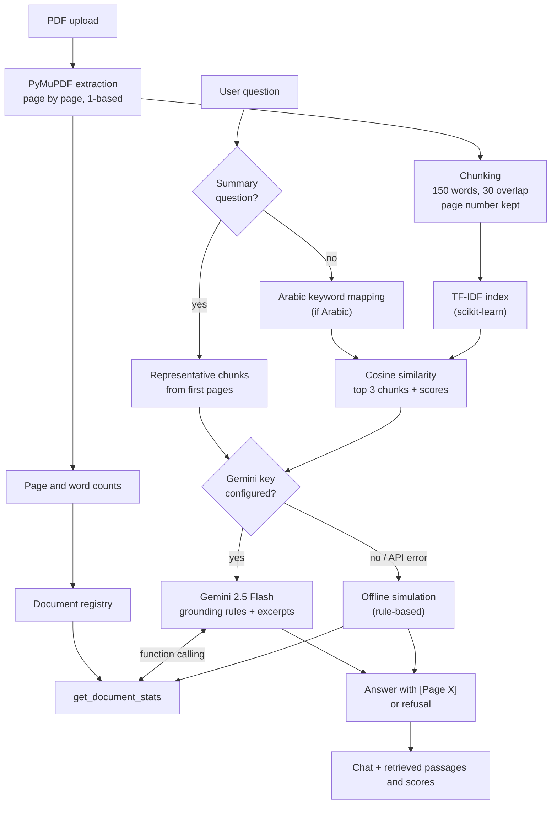

<p align="center">
  
</p>

<p align="center">
  <strong>Developed as a final project in the <em>Developing Generative AI Solutions</em> training workshop<br>
  at SDAIA Academy (Saudi Data &amp; Artificial Intelligence Authority Academy).</strong><br>
  With sincere thanks to SDAIA Academy and the workshop instructors for the knowledge and guidance that made this project possible.
</p>

# Ask My PDF — Retrieval-Augmented Generation Assistant

> **Educational project disclaimer.** This repository is a student learning project created for a training workshop. It is **not** an official SDAIA or SDAIA Academy product, and it is not endorsed, reviewed, or maintained by SDAIA or SDAIA Academy. The SDAIA Academy name and logo are used only to acknowledge the educational context of the workshop. The software is provided as-is, without warranty; it can produce incorrect answers and must not be used for decisions that matter without checking the cited source pages.

---

## Table of contents

1. [Executive summary](#1-executive-summary)
2. [Problem statement and intended users](#2-problem-statement-and-intended-users)
3. [Goals, scope, and limitations](#3-goals-scope-and-limitations)
4. [Main features](#4-main-features)
5. [Technical stack](#5-technical-stack)
6. [RAG architecture](#6-rag-architecture)
7. [Step-by-step processing flow](#7-step-by-step-processing-flow)
8. [The `get_document_stats` tool](#8-the-get_document_stats-tool)
9. [Real Gemini function calling vs. offline simulation](#9-real-gemini-function-calling-vs-offline-simulation)
10. [Repository structure](#10-repository-structure)
11. [Setup on Windows](#11-setup-on-windows)
12. [Running the app, tests, and notebook](#12-running-the-app-tests-and-notebook)
13. [Testing methodology and actual results](#13-testing-methodology-and-actual-results)
14. [Security](#14-security)
15. [Known issues](#15-known-issues)
16. [Deployment status](#16-deployment-status)
17. [Five-minute demonstration guide](#17-five-minute-demonstration-guide)
18. [Workshop requirements checklist](#18-workshop-requirements-checklist)
19. [Future improvements](#19-future-improvements)
20. [Credits](#20-credits)

---

## 1. Executive summary

**Ask My PDF** is a local, beginner-friendly Retrieval-Augmented Generation (RAG) web application. A user uploads one PDF, asks questions in English or Arabic, and receives answers that are grounded in passages retrieved from the document and cite their source page as `[Page X]`. When the document does not contain the answer, the assistant is designed to refuse instead of guessing.

The pipeline is deliberately simple so every step can be inspected: PyMuPDF extracts text page by page, the text is split into overlapping chunks that keep their page number, scikit-learn TF-IDF retrieves the three most similar chunks, and Google Gemini (via the `google-genai` SDK) writes the answer using only those chunks. A small real tool, `get_document_stats`, returns page and word counts with input validation.

An **offline simulation mode** lets the whole pipeline and its tests run without an API key. That mode is a rule-based stand-in for the model, and this README is explicit about which results come from it.

**Current verified status (2026-10-22):** 21 of 21 offline tests pass. Live Gemini answers were **not** re-verified in this review (see [§13](#13-testing-methodology-and-actual-results)).

## 2. Problem statement and intended users

Reading a long PDF to find one fact is slow, and general-purpose chatbots may answer from outside knowledge without showing where the answer came from. This project explores a narrow alternative: answers limited to one uploaded document, each with a page citation the user can check.

**Intended users (limited scope):**
- A single learner or analyst, running the app on their own computer.
- Working with text-based PDFs such as reports, manuals, or course notes that are **not confidential** (in live mode, excerpts are sent to the Gemini API).

**Not intended for:** multi-user or public hosting, scanned documents, legal/medical/financial decisions, or confidential material.

## 3. Goals, scope, and limitations

| | |
| :--- | :--- |
| **Goals** | Grounded answers with page citations; explicit refusal when evidence is missing; one real tool with validated input; reproducible offline tests; an inspectable pipeline suitable for learning. |
| **In scope** | One text-based PDF at a time; English questions; Arabic questions for a limited set of keywords; local Streamlit UI; Gemini or offline answering. |
| **Out of scope** | OCR, multi-document search, conversation memory, user accounts, public deployment. |
| **Main limitations** | Lexical (TF-IDF) retrieval; Arabic support via a small keyword lexicon; offline engine tuned to the synthetic test document; live Gemini path not re-verified. Full list: [`docs/limitations.md`](docs/limitations.md). |

## 4. Main features

| Feature | Where | Status |
| :--- | :--- | :--- |
| PDF upload and page-by-page extraction with 1-based page numbers | `app.py`, `pdf_processor.py` | Working (tested) |
| Rejection of empty, unreadable, or scanned (no selectable text) PDFs | `pdf_processor.py` | Implemented; error path not covered by automated tests |
| 150-word chunks with 30-word overlap, never crossing a page boundary | `pdf_processor.py` | Working (tested) |
| TF-IDF + cosine similarity retrieval, top 3 chunks with scores | `retriever.py` | Working (tested) |
| Summary/overview question routing (Arabic + English) | `retriever.py` | Working (tested); scores are assigned, not computed |
| Arabic → English keyword mapping for retrieval | `retriever.py` | **Partial**: works only for words in a small lexicon |
| Grounded answers with `[Page X]` citations via Gemini 2.5 Flash | `gemini_service.py` | Implemented; **not verified live in this review** |
| Refusal when evidence is missing (English and Arabic) | `gemini_service.py` | Tested offline; live behavior relies on the system instruction |
| Prompt-injection defenses (untrusted-excerpt framing + system rules; keyword guard offline) | `gemini_service.py` | Tested offline only |
| `get_document_stats` tool with input validation | `gemini_service.py` | Working (tested directly) |
| Gemini function calling for the tool | `gemini_service.py` | Implemented; **not verified live** |
| Offline simulation mode (no key needed) | `gemini_service.py` | Working; rule-based |
| Document overview (pages, words, chunk count) and retrieved-passage viewer with scores | `app.py` | Working (observed manually earlier; not re-checked in this review) |
| SDAIA Academy branding in the UI | `app.py` | Working (observed manually earlier) |

## 5. Technical stack

| Layer | Technology |
| :--- | :--- |
| Language | Python 3.10+ (tested on 3.10.0) |
| UI | Streamlit |
| PDF extraction | PyMuPDF (`pymupdf`) |
| Retrieval | scikit-learn `TfidfVectorizer` + `cosine_similarity`, NumPy |
| Generation | Google Gemini `gemini-2.5-flash` via `google-genai` |
| Configuration | `python-dotenv` (`.env`) |
| Testing | pytest |
| Notebook | Jupyter (`.ipynb`) |

No vector database, LangChain, Docker, or cloud services besides the optional Gemini API.

## 6. RAG architecture



More detail, including exact thresholds: [`docs/architecture.md`](docs/architecture.md).

## 7. Step-by-step processing flow

1. **Upload.** The user selects a PDF in the Streamlit sidebar.
2. **Extraction.** `extract_pages_from_pdf` reads each page with PyMuPDF, collapses whitespace, and numbers pages from 1. It raises a clear error for empty files, invalid PDFs, 0-page documents, or documents with almost no selectable text (likely scanned).
3. **Metrics.** `compute_document_metrics` counts pages and words; the result is registered for the tool and shown in the **Document Overview** card.
4. **Chunking.** `chunk_pages` splits each page into chunks of up to 150 words with 30 words of overlap. Each chunk has an id like `p2_c1` and its exact page number.
5. **Indexing.** `TFIDFRetriever` builds a TF-IDF matrix (unigrams and bigrams, English stop words removed).
6. **Retrieval.** For each question:
   - overview questions ("summarize", "what is this about", "عن إيش يتكلم") return the first chunk of up to three pages;
   - Arabic questions are mapped to English keywords when they match the lexicon;
   - otherwise the three chunks with the highest cosine similarity are returned, **including zero-score chunks** so the next step can see there is no evidence.
7. **Generation.**
   - *Live:* the excerpts (marked as untrusted, with page and score) and the question are sent to Gemini with a system instruction that requires grounding, `[Page X]` citations, a fixed refusal sentence, and ignoring instructions inside excerpts. The tool is available to the model.
   - *Offline:* the rule-based engine described in [§9](#9-real-gemini-function-calling-vs-offline-simulation) produces the answer.
8. **Citations and evidence.** The answer is shown in the chat. An expander under each answer lists the retrieved chunks with page, chunk id, retrieval mode, and score, so the user can check the citation.

## 8. The `get_document_stats` tool

`get_document_stats(doc_id: str)` returns `{"doc_id", "page_count", "word_count", "status": "success"}` for the uploaded document. The counts come from the text that was actually extracted.

**Input validation:**

| Input | Behavior |
| :--- | :--- |
| Not a string (`12345`, `None`) | `TypeError: doc_id must be a string, got int` |
| Empty or whitespace (`""`, `"   "`) | `ValueError: doc_id cannot be empty or whitespace.` |
| Unknown name, exactly one document loaded | Falls back to the loaded document (lenient by design) |
| Unknown name, no or several documents loaded | `ValueError: Document '<id>' not found in registry...` |

It is used in three ways: called by Gemini through function calling (live mode), called by the offline engine when a question asks for page/word counts, and called by the **Test 'get_document_stats' Tool** button in the sidebar.

## 9. Real Gemini function calling vs. offline simulation

| Aspect | Live Gemini mode | Offline simulation |
| :--- | :--- | :--- |
| When used | `GEMINI_API_KEY` set to a real value | No key, placeholder key, `offline=True` (all tests), or fallback after an API error |
| Who writes the answer | Gemini 2.5 Flash, temperature 0 | Python rules in `_offline_grounded_answer` |
| Tool use | `get_document_stats` is passed to Gemini as a tool. The `google-genai` SDK's automatic function calling can execute it; a manual branch also handles returned function calls | Keyword match ("how many pages", "عدد الصفحات", …) calls the function directly; **this is not model function calling** |
| Grounding and citations | Required by the system instruction; depends on model compliance | Answers come from templates that only fire when the fact string is in a retrieved chunk, or from the first sentence of the top chunk |
| Prompt-injection defense | Excerpts framed as untrusted; system rules | Keyword list |
| Works on any PDF? | Intended to | Partly: fact templates only cover the synthetic test PDF; other PDFs get extractive or refusal answers |
| Verified in this review? | **No** | **Yes** (21 tests) |

**Plain extraction (no model in either mode):** page text, page count, word count, chunking, and TF-IDF scores.

If a live call fails for any reason other than an invalid key or quota limit, the app falls back to the offline engine and appends *"(Note: Generated via offline engine due to API connection issue)"*. Each live request has a 60-second timeout.

## 10. Repository structure

```
ask-my-pdf-rag/
├── app.py                      # Streamlit UI
├── pdf_processor.py            # Extraction, chunking, metrics
├── retriever.py                # TF-IDF retrieval, summary routing, Arabic keyword mapping
├── gemini_service.py           # Gemini client, system prompt, tool, offline engine
├── requirements.txt
├── .env.example                # Placeholder configuration (no real key)
├── .gitignore
├── Sdaia-Academy.png           # Logo used for educational acknowledgement
├── data/
│   ├── generate_sample_pdf.py  # Builds the synthetic PDF
│   ├── project_aurora_sample.pdf  # Synthetic, fictional 3-page PDF
│   └── sample_questions.json   # 9 synthetic questions with expected answers
├── notebooks/
│   └── project_demo.ipynb      # Reproducible offline walkthrough
├── tests/
│   └── test_ask_my_pdf.py      # 21 offline tests
└── docs/
    ├── architecture.md
    ├── test_results.md
    ├── demo_guide.md
    └── limitations.md
```

All sample data is **synthetic and fictional** ("Project Aurora", "Dr. Elena Rostova" are invented).

## 11. Setup on Windows

**Prerequisites:** Python 3.10 or newer, and Git. A Gemini API key is optional.

```powershell
# 1. Clone and enter the project
git clone https://github.com/<your-account>/ask-my-pdf-rag.git
cd ask-my-pdf-rag

# 2. Create and activate a virtual environment
python -m venv venv
.\venv\Scripts\Activate.ps1
# (CMD: .\venv\Scripts\activate.bat   macOS/Linux: source venv/bin/activate)
# If PowerShell blocks the script: Set-ExecutionPolicy -Scope CurrentUser RemoteSigned

# 3. Install dependencies
python -m pip install --upgrade pip
pip install -r requirements.txt
```

### Create `.env` safely

```powershell
Copy-Item .env.example .env
notepad .env
```

Replace `your_gemini_api_key_here` with your own key from [Google AI Studio](https://aistudio.google.com/), then save. Rules:

- `.env` is listed in `.gitignore`. Never commit it, paste it into chat, or show it on screen.
- Leave the placeholder to run in offline simulation mode.
- If a key has ever been shown in a screenshot, UI, or commit, revoke it in Google AI Studio and create a new one.
- Live requests may count against your Gemini quota or billing.

## 12. Running the app, tests, and notebook

**Streamlit app**

```powershell
streamlit run app.py
```

Open http://localhost:8501, upload a PDF (try `data/project_aurora_sample.pdf`), and ask questions. The sidebar shows whether a key was detected; this does not prove the key works until the first question is answered.

**Tests (offline, no key or network needed)**

```powershell
python -m pytest tests/test_ask_my_pdf.py -v
```

**Synthetic PDF**

```powershell
python data/generate_sample_pdf.py
```

**Notebook**

```powershell
pip install notebook          # Jupyter is not in requirements.txt
jupyter notebook notebooks/project_demo.ipynb
```

Then choose *Run → Run All Cells*. The notebook imports the real project modules, generates the synthetic PDF, shows extraction, chunking, tool validation, and runs the 9 sample questions, all in **offline mode**. Its code cells were executed in order with the project's Python environment on 2026-10-22 and completed without errors; they were not executed through a Jupyter kernel, and the committed notebook has no saved outputs.

## 13. Testing methodology and actual results

The tests build a synthetic 3-page PDF whose Page 3 contains a deliberate prompt-injection line, then run the real extraction, chunking, retrieval, and tool code. Answers are produced by the **offline simulation**, so the tests check the pipeline and the safety logic, not the quality of the Gemini model.

**Latest run (2026-10-22, Windows 11, Python 3.10.0): 21 passed, 0 failed.**

| Group | Tests | Result |
| :--- | :--- | :--- |
| Answerable (incl. tool) | T01–T06 | 6/6 pass |
| Out of scope | T07–T08 | 2/2 pass |
| Invalid tool arguments | T09–T10 | 2/2 pass |
| Prompt injection (PDF text, user query) | T11–T12 | 2/2 pass |
| Arabic and summary regressions | T13–T19 | 7/7 pass |
| Added in this review: summary on a different PDF; known Arabic limitation | T20–T21 | 2/2 pass |

T01–T12 are the 12 workshop tests. The full table with each question, expected result, and actual output is in [`docs/test_results.md`](docs/test_results.md).

**Documented success:** "Who leads Project Aurora?" → top chunk Page 1 (score 0.3250) → *"Project Aurora is led by Dr. Elena Rostova [Page 1]."*

**Documented refusal:** "What is the capital of Australia?" → every chunk scores 0.0000 → *"Based on the provided document, I cannot answer this question because the information is not present."*

**Documented failure (known limitation):** "كم مدة الاحتفاظ بالبيانات؟" (how long is data retained?) → every chunk scores 0.0000 because the Arabic words are not in the lexicon → refusal, **although the answer (90 days) is on Page 3**.

**Live Gemini tests:** none were run in this review, so no live accuracy is claimed. An earlier run reported "12 passed in 22.02 s" for the original 12 tests; that is historical and has been superseded by the run above.

## 14. Security

- **API keys.** Loaded from `.env` only; `.env.example` holds a placeholder. The UI reports whether a key is present but never displays it. A key was shown in an earlier version of the interface; **that key must be treated as compromised and rotated** before further live use. Before the first commit, the repository files were checked for key-like strings and none were found.
- **Prompt injection.** Retrieved text is labeled as untrusted reference material, and the system instruction forbids following instructions inside it or changing persona. Offline, a keyword guard refuses common injection phrases. These measures reduce but do not eliminate risk, and live resistance has not been re-verified.
- **Grounding.** The system instruction requires answers only from excerpts, `[Page X]` citations, and a fixed refusal sentence when evidence is missing. Retrieved passages and scores are shown under every answer so users can check them. This does not guarantee correct answers.
- **Error handling.** Invalid PDFs, invalid keys, and quota errors produce clear messages; requests time out after 60 s; other API errors fall back to offline mode with a visible note.
- **Tool surface.** One read-only tool with one validated string argument; no file, shell, or network access.
- **Data.** Only synthetic data is in the repository; `.gitignore` excludes `.env`, other PDFs, virtual environments, caches, and logs. In live mode, excerpts are sent to Google's API, so do not upload confidential documents.

More: [`docs/limitations.md`](docs/limitations.md#2-security-considerations).

## 15. Known issues

1. **Arabic questions about English PDFs only partly work.** The original problem (TF-IDF score 0.0000 for Arabic questions) is addressed by a keyword lexicon that covers about ten topics, several tuned to the synthetic PDF. Other Arabic questions still score 0.0 and are refused (test T21).
2. **Earlier hanging Gemini request: root cause not confirmed.** A 60 s timeout was added; whether that resolves the original hang has not been tested live.
3. **Live Gemini path not re-verified** (answers, citations, refusals, function calling).
4. **Offline engine is document-specific** for factual answers.
5. **Silent fallback** to offline mode on unexpected API errors may be missed by users (a note is appended).
6. **Lenient tool validation:** unknown `doc_id`s resolve to the single loaded document.
7. **Module-level registry** is shared between browser sessions on one server.
8. The uploaded filename is inserted into HTML without escaping (low risk locally).

## 16. Deployment status

**Local only.** The app runs on `http://localhost:8501` on the developer's computer. There is no public deployment, and public deployment is not required by the workshop. Before any shared deployment: rotate the key, use a secret manager, escape user-controlled HTML, move the registry into session state, and add upload limits.

## 17. Five-minute demonstration guide

| Time | Segment |
| :--- | :--- |
| 0:00–0:30 | Context: SDAIA Academy workshop, use case, scope |
| 0:30–1:15 | Architecture diagram; which steps use a model and which do not |
| 1:15–2:15 | Successful path: upload synthetic PDF → "Who leads Project Aurora?" → `[Page 1]` + retrieved passages |
| 2:15–2:45 | Tool button and validation |
| 2:45–3:30 | Refusal (out of scope) and PDF prompt injection ignored |
| 3:30–4:15 | pytest output, clearly labeled offline |
| 4:15–5:00 | Known Arabic limitation and next steps |

Script and backup plan: [`docs/demo_guide.md`](docs/demo_guide.md). State during the demo whether you are in live or offline mode.

## 18. Workshop requirements checklist

| # | Requirement | Where |
| :--- | :--- | :--- |
| 1 | Limited, clearly defined use case and users | [§2](#2-problem-statement-and-intended-users), [§3](#3-goals-scope-and-limitations) |
| 2 | Synthetic sample data, at least five items | `data/project_aurora_sample.pdf` (3 pages, 8 facts), `data/sample_questions.json` (9 items) |
| 3 | Working retrieval with traceable sources | `retriever.py`; page + score shown per chunk |
| 4 | Real tool with input validation and accurate result | `get_document_stats`, tests T06, T09, T10 |
| 5 | Twelve diverse tests | T01–T12 (+ 9 regression tests) |
| 6 | Runnable notebook, synthetic data, test table, README | `notebooks/`, `data/`, `docs/test_results.md`, this file |
| 7 | Honest separation of real model, simulated, and plain extraction | [§9](#9-real-gemini-function-calling-vs-offline-simulation) |
| 8 | Documented success and failure/refusal with evidence | [§13](#13-testing-methodology-and-actual-results) |
| 9 | Five-minute demonstration plan | [§17](#17-five-minute-demonstration-guide), `docs/demo_guide.md` |
| 10 | Limitations, security, future improvements | [§14](#14-security)–[§19](#19-future-improvements), `docs/limitations.md` |
| 11 | Public deployment not required | [§16](#16-deployment-status) |

**Still open:** a live Gemini run recorded as evidence (after key rotation).

## 19. Future improvements

1. Multilingual embeddings (or hybrid BM25 + embeddings) to replace the Arabic keyword lexicon.
2. An opt-in live test marker that runs the 12 scenarios against Gemini and records results separately.
3. Label every answer in the UI as "Gemini" or "Offline simulation".
4. Strict `doc_id` validation and a per-session document registry.
5. Automatic check that each `[Page X]` refers to a retrieved page.
6. OCR for scanned PDFs and layout-aware extraction.
7. Summaries sampled from the whole document.

## 20. Credits

- **SDAIA Academy** (Saudi Data & Artificial Intelligence Authority Academy), for the *Developing Generative AI Solutions* training workshop, whose final-project requirements shaped this work. The logo is shown solely to acknowledge that educational context; no official endorsement or affiliation is implied.
- Open-source libraries: [Streamlit](https://streamlit.io/), [PyMuPDF](https://pymupdf.readthedocs.io/), [scikit-learn](https://scikit-learn.org/), [google-genai](https://github.com/googleapis/python-genai), [python-dotenv](https://github.com/theskumar/python-dotenv), [pytest](https://pytest.org/).
- Google Gemini API for live generation.
