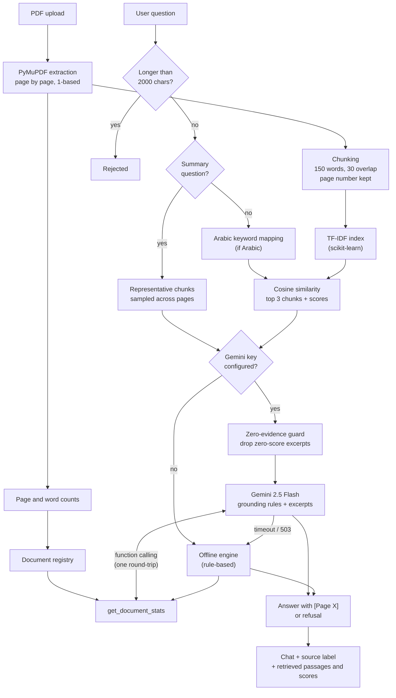

<p align="center">
  
</p>

<p align="center"><strong>SDAIA Academy</strong></p>

<h1 align="center">Ask My PDF — Retrieval-Augmented Generation Assistant</h1>

<p align="center"><strong>Developed by Team 2</strong></p>

<p align="center">
  Final project for the <em>Developing Generative AI Solutions</em> training workshop at SDAIA Academy
  (Saudi Data &amp; Artificial Intelligence Authority Academy).<br>
  With sincere thanks to SDAIA Academy and the workshop instructors for the knowledge and guidance that made this project possible.
</p>

> **Educational project disclaimer.** This repository is a student learning project created for a training workshop. It is **not** an official SDAIA or SDAIA Academy product, and it is not endorsed, reviewed, or maintained by SDAIA or SDAIA Academy. The SDAIA Academy name and logo are used only to acknowledge the educational context of the workshop. The software is provided as-is, without warranty; it can produce incorrect answers and must not be used for decisions that matter without checking the cited source pages.

---

## Table of contents

1. [Project overview](#1-project-overview)
2. [Problem statement](#2-problem-statement)
3. [Objectives](#3-objectives)
4. [Target users and scope](#4-target-users-and-scope)
5. [Features](#5-features)
6. [Technology stack](#6-technology-stack)
7. [RAG architecture](#7-rag-architecture)
8. [PDF extraction and chunking](#8-pdf-extraction-and-chunking)
9. [TF-IDF and cosine-similarity retrieval](#9-tf-idf-and-cosine-similarity-retrieval)
10. [Gemini integration](#10-gemini-integration)
11. [Tool calling and validation](#11-tool-calling-and-validation)
12. [Offline fallback and answer-source labels](#12-offline-fallback-and-answer-source-labels)
13. [Page citations](#13-page-citations)
14. [Security considerations](#14-security-considerations)
15. [Repository structure](#15-repository-structure)
16. [Setup and installation](#16-setup-and-installation)
17. [Environment configuration](#17-environment-configuration)
18. [Running the Streamlit app](#18-running-the-streamlit-app)
19. [Running the tests and notebook](#19-running-the-tests-and-notebook)
20. [Test results](#20-test-results)
21. [Limitations](#21-limitations)
22. [Deployment (Streamlit Community Cloud)](#22-deployment-streamlit-community-cloud)
23. [Five-minute demonstration](#23-five-minute-demonstration)
24. [Workshop requirements checklist](#24-workshop-requirements-checklist)
25. [Future improvements](#25-future-improvements)
26. [Credits](#26-credits)

---

## 1. Project overview

**Ask My PDF** is a beginner-friendly Retrieval-Augmented Generation (RAG) web application. A user uploads one PDF, asks questions in English or Arabic, and receives answers grounded in passages retrieved from that document, each citing its source as `[Page X]`. When the document does not contain the answer, the assistant is designed to refuse rather than guess.

The pipeline is deliberately simple so every step can be inspected: PyMuPDF extracts text page by page, the text is split into overlapping chunks that keep their page number, scikit-learn TF-IDF retrieves the most similar chunks, and Google Gemini (via the `google-genai` SDK) writes the answer from those chunks. A small real tool, `get_document_stats`, returns page and word counts with input validation. An **offline engine** lets the app and its tests run without an API key; every answer in the UI is labeled with where it came from.

**Status (2026-10-22):**
- **Automated tests:** 35 of 35 pass. They run offline or against a mocked Gemini client, and make no API calls.
- **Live Gemini run:** real Gemini answered 8 of 9 English and Arabic test questions correctly with page citations, including a genuine `get_document_stats` function call. The 9th was blocked by the API quota. See [§20](#20-test-results).
- **Deployment:** none. The project runs locally and is prepared for Streamlit Community Cloud ([§22](#22-deployment-streamlit-community-cloud)).

## 2. Problem statement

Finding one fact in a long PDF is slow, and general-purpose chatbots may answer from outside knowledge without showing where an answer came from. Ask My PDF explores a narrow alternative: answers limited to a single uploaded document, each with a page citation the user can check, and an explicit refusal when the document does not contain the answer.

## 3. Objectives

1. Answer questions **only from the uploaded document**, with `[Page X]` citations.
2. **Refuse** out-of-scope questions instead of guessing.
3. Provide one **real tool** (`get_document_stats`) with strict input validation.
4. Resist **prompt injection** hidden in documents or questions.
5. Support **Arabic questions** about English documents (partially; see [§21](#21-limitations)).
6. Keep the pipeline **transparent**: show retrieved passages, scores, and the answer source.
7. Be **reproducible**: offline tests, synthetic data, and a demo notebook.

## 4. Target users and scope

**Intended users:** a learner, analyst, or small team working with text-based PDFs such as reports, manuals, or course notes that are **not confidential** (in live mode, excerpts are sent to the Gemini API).

| | |
| :--- | :--- |
| **In scope** | One text-based PDF at a time; English questions; Arabic questions (limited, see §21); Streamlit UI; Gemini or offline answering. |
| **Out of scope** | OCR for scanned PDFs, multi-document search, conversation memory, user accounts, legal/medical/financial decisions. |

## 5. Features

| Feature | Where | Status |
| :--- | :--- | :--- |
| PDF upload; page-by-page extraction with 1-based page numbers | `app.py`, `pdf_processor.py` | Verified (tests, headless app check) |
| Rejection of empty, unreadable, or scanned (no selectable text) PDFs | `pdf_processor.py` | Verified manually (blank and 0-byte PDFs rejected) |
| 150-word chunks with 30-word overlap, never crossing a page | `pdf_processor.py` | Verified (tests) |
| TF-IDF + cosine-similarity retrieval, top 3 chunks with scores | `retriever.py` | Verified (tests) |
| English and Arabic summary questions, sampled across the document | `retriever.py`, `gemini_service.py` | Verified offline (tests) and live (L03, L04) |
| Arabic → English keyword mapping for retrieval | `retriever.py` | **Partial**: small keyword list (see §21) |
| Grounded Gemini answers with `[Page X]` citations | `gemini_service.py` | Verified live on 8 questions |
| Refusal when evidence is missing | `gemini_service.py` | Verified offline (tests) and live (L05) |
| Zero-evidence guard: unrelated zero-score excerpts are not sent to Gemini | `gemini_service.py` | Verified with mocked client (T32); not yet re-run live |
| Prompt-injection defenses | `gemini_service.py` | Verified offline (tests) and in one live case (L06) |
| `get_document_stats` tool with validation | `gemini_service.py` | Verified (tests) and live function call (L07) |
| Answer-source label under every answer (Gemini / local engine / API error) | `app.py` | Verified (headless app check, T34) |
| Offline engine and labeled fallback when Gemini is unavailable | `gemini_service.py` | Verified (tests; live 503 fallback observed) |
| Question length limit (execution limit) | `gemini_service.py` | Verified (T33) |
| Document overview and retrieved-passage viewer | `app.py` | Verified (headless app check) |
| SDAIA Academy logo in the app | `app.py` | Verified (headless app check) |
| API key from `.env`, environment, or Streamlit secrets | `app.py` | Verified (headless app check with a fake secret) |

## 6. Technology stack

| Layer | Technology (version tested) |
| :--- | :--- |
| Language | Python 3.10 locally; dependencies verified to resolve for Python 3.12 / Linux |
| UI | Streamlit 1.65.0 |
| PDF extraction | PyMuPDF 1.28.2 |
| Retrieval | scikit-learn 1.7.2 (`TfidfVectorizer`, `cosine_similarity`), NumPy 2.2.6 |
| Generation | Google Gemini `gemini-2.5-flash` via `google-genai` 2.32.0 |
| Configuration | `python-dotenv` 1.2.4 (`.env`), Streamlit secrets |
| Testing | pytest 9.1.1 |
| Notebook | Jupyter (`.ipynb`) |

No vector database, LangChain, Docker, or paid services besides the optional Gemini API.

## 7. RAG architecture



Detailed design and thresholds: [`docs/architecture.md`](docs/architecture.md).

## 8. PDF extraction and chunking

- **Extraction (no AI involved).** `extract_pages_from_pdf` opens the upload with PyMuPDF, reads each page's text, collapses whitespace, and numbers pages from 1. It rejects 0-byte files, unreadable files, 0-page documents, and documents with fewer than 15 extracted characters (typically scanned images) with a clear message.
- **Metrics.** `compute_document_metrics` counts pages and words; they appear in the **Document Overview** card and feed the tool.
- **Chunking.** `chunk_pages` splits each page into chunks of up to 150 words with 30 words of overlap. Chunks never span two pages, so each chunk's page number is exact. Chunk ids look like `p2_c1`.

## 9. TF-IDF and cosine-similarity retrieval

`TFIDFRetriever` fits a `TfidfVectorizer` (unigrams and bigrams, English stop words removed) over all chunks. For each question:

1. **Summary questions** ("summarize", "what's this PDF about?", "عن إيش يتكلم", …) return the first chunk of up to four pages sampled from the start, middle, and end of the document. Their score (0.95) is an assigned constant, not a similarity.
2. **Arabic questions** are mapped to English search keywords using a small keyword list (e.g. "يقود" → "lead", "تقنيات" → "technology tools software …").
3. Otherwise the **top 3 chunks by cosine similarity** are returned with their scores.
4. If every score is 0 and the document has no more chunks than requested, the chunks are labeled `full_document`: they are the whole (short) document, so they still count as evidence.

## 10. Gemini integration

- **Model:** `gemini-2.5-flash`, temperature 0, via the official `google-genai` SDK.
- **Prompt:** retrieved excerpts are labeled *untrusted reference material*, each with page, chunk id, retrieval mode, and similarity. The system instruction requires answers only from excerpts, `[Page X]` citations, the question's language, a fixed refusal sentence when evidence is missing, and ignoring any instructions inside the document.
- **Zero-evidence guard:** zero-score excerpts are removed before the request, except summary and `full_document` chunks, so Gemini cannot answer from unrelated text.
- **Limits:** 20-second timeout per request; questions over 2000 characters are rejected before any API call; at most one tool round-trip per question.
- **Errors:** 401/403/404/429 produce a clear warning; timeouts, 503 "model overloaded", and other errors fall back to the offline engine, with the fallback labeled in the answer.

## 11. Tool calling and validation

`get_document_stats(doc_id: str)` returns `{"doc_id", "page_count", "word_count", "status": "success"}` for the uploaded document.

| Input | Behavior |
| :--- | :--- |
| Not a string (`12345`, `None`) | `TypeError: doc_id must be a string, got int` |
| Empty or whitespace (`""`, `"   "`) | `ValueError: doc_id cannot be empty or whitespace.` |
| Same name with different case, spacing, or without `.pdf` | Resolves to the loaded document |
| Any other name, even when only one document is loaded | `ValueError: Document '<id>' not found in registry...` |

**Live function calling:** the tool is declared to Gemini; the SDK's automatic function-calling loop is disabled. If Gemini requests the tool, the app runs it once and sends the result back in a single follow-up request without tools, so no loop is possible. Invalid arguments from the model are returned to it as `{"status": "error", ...}` instead of crashing the request. Verified live in L07 (Gemini called `get_document_stats` with the correct name) and with mocked clients in T28 and T30.

**Offline:** keyword detection ("how many pages", "عدد الصفحات", …) calls the function directly. This is ordinary Python, **not** model function calling.

## 12. Offline fallback and answer-source labels

Every answer in the chat carries a caption showing its origin:

| Caption | Meaning |
| :--- | :--- |
| 🤖 Answered by Gemini 2.5 Flash | Real model output |
| 💻 Answered by the local offline engine (Gemini not configured) | No key configured |
| 💻 Answered by the local offline engine (Gemini was unavailable) | Timeout, 503, or other error; the answer also ends with a notice |
| ⚠️ Gemini API error (no answer generated) | 401/403/404/429 |

The **offline engine** is a deterministic, rule-based component (not a language model). It refuses injection phrases and zero-evidence questions, answers statistics questions via the tool, builds extractive summaries from the actual document, and otherwise returns the best-matching sentence with its page. It has fact templates written for the synthetic test document, so on other PDFs it is much less capable than Gemini.

## 13. Page citations

- Page numbers come from extraction (1-based) and stay attached to every chunk; chunks never cross pages.
- Gemini is instructed to cite every fact as `[Page X]`; the offline engine cites the page of the chunk it used.
- Under every answer, **View Retrieved Document Chunks** shows page, chunk id, retrieval mode, and score for each passage, so users can check that a citation points to the right page.
- Citations are not automatically validated against the retrieved pages (see §25).

## 14. Security considerations

- **API keys.** Read from `.env` (local), environment variables, or Streamlit secrets (cloud). The key is never displayed; the UI only reports whether one is present. `.env` and `.streamlit/secrets.toml` are gitignored; `.env.example` and `.streamlit/secrets.toml.example` contain placeholders only. A key exposed in an earlier version of the interface has been revoked and replaced by the team.
- **Prompt injection.** Excerpts are labeled untrusted and the system instruction forbids following embedded instructions; offline, a keyword guard refuses common injection phrases. This lowers risk but does not eliminate it; Gemini ignored an embedded injection in the one live test (L06).
- **Grounding.** Answers are restricted to excerpts with citations and a refusal rule; zero-score excerpts are not sent. This does not guarantee correct answers.
- **Execution limits.** 20 s request timeout, 2000-character question limit, a single tool round-trip, and a 25 MB upload limit (`.streamlit/config.toml`).
- **Tool surface.** One read-only tool with one validated string argument; no file, shell, or network access.
- **Output safety.** The uploaded filename is HTML-escaped before display.
- **Data.** Only synthetic sample data is in the repository. In live mode, retrieved excerpts and the question are sent to Google's Gemini API; do not upload confidential documents.

More: [`docs/limitations.md`](docs/limitations.md#2-security-considerations).

## 15. Repository structure

```
ask-my-pdf-rag/
├── app.py                         # Streamlit UI (entry point)
├── pdf_processor.py               # Extraction, chunking, metrics
├── retriever.py                   # TF-IDF retrieval, summary routing, Arabic keyword mapping
├── gemini_service.py              # Gemini client, system prompt, tool, offline engine
├── requirements.txt               # Pinned, tested dependency versions
├── .env.example                   # Placeholder configuration (no real key)
├── .gitignore
├── .streamlit/
│   ├── config.toml                # Upload limit, telemetry off
│   └── secrets.toml.example       # Secrets template (placeholder only)
├── Sdaia-Academy.png              # Logo used for educational acknowledgement
├── data/
│   ├── generate_sample_pdf.py     # Builds the synthetic PDF
│   ├── project_aurora_sample.pdf  # Synthetic, fictional 3-page PDF
│   └── sample_questions.json      # 9 synthetic questions with expected answers
├── notebooks/
│   └── project_demo.ipynb         # Reproducible offline walkthrough
├── tests/
│   └── test_ask_my_pdf.py         # 35 tests (offline + mocked Gemini; no API calls)
└── docs/
    ├── architecture.md
    ├── test_results.md
    ├── demo_guide.md
    ├── limitations.md
    └── deployment.md
```

All sample data is **synthetic and fictional** ("Project Aurora", "Dr. Elena Rostova" are invented).

## 16. Setup and installation

**Prerequisites:** Python 3.10–3.12 and Git. A Gemini API key is optional.

```powershell
# 1. Clone and enter the project
git clone https://github.com/<your-account>/ask-my-pdf-rag.git
cd ask-my-pdf-rag

# 2. Create and activate a virtual environment
python -m venv venv
.\venv\Scripts\Activate.ps1
# (CMD: .\venv\Scripts\activate.bat   macOS/Linux: source venv/bin/activate)
# If PowerShell blocks the script: Set-ExecutionPolicy -Scope CurrentUser RemoteSigned

# 3. Install dependencies
python -m pip install --upgrade pip
pip install -r requirements.txt
```

## 17. Environment configuration

The app looks for `GEMINI_API_KEY` in this order: environment variable / `.env` file, then Streamlit secrets. Without a key it runs in offline mode.

**Local (`.env`):**

```powershell
Copy-Item .env.example .env
notepad .env      # replace your_gemini_api_key_here with your key from https://aistudio.google.com/
```

**Streamlit Community Cloud:** paste `GEMINI_API_KEY = "<your key>"` into the app's **Settings → Secrets** (see [§22](#22-deployment-streamlit-community-cloud)).

Rules: never commit `.env` or `secrets.toml`, never paste keys into chats or screenshots, and revoke any key that was ever exposed. Live requests count against your Gemini quota (the free tier returned `429` after about 5 rapid requests in testing).

## 18. Running the Streamlit app

```powershell
streamlit run app.py
```

Open http://localhost:8501, upload a PDF (try `data/project_aurora_sample.pdf`), and ask questions. The sidebar shows whether a key was detected (this does not prove it works until the first answer), and each answer shows its source label and the retrieved passages.

## 19. Running the tests and notebook

**Tests (offline; no key or network needed):**

```powershell
python -m pytest tests/test_ask_my_pdf.py -v
```

**Synthetic PDF:** `python data/generate_sample_pdf.py`

**Notebook:**

```powershell
pip install notebook          # Jupyter is not in requirements.txt
jupyter notebook notebooks/project_demo.ipynb
```

Choose *Run → Run All Cells*. The notebook imports the real modules, generates the synthetic PDF, shows extraction, chunking, tool validation, and runs the 9 sample questions in **offline mode**. Its 7 code cells were executed in order with the project's Python environment on 2026-10-22 without errors; they were not run through a Jupyter kernel, and the committed notebook has no saved outputs.

## 20. Test results

Full tables: [`docs/test_results.md`](docs/test_results.md).

### Automated tests (offline and mocked; no API calls)

**Latest run: 2026-10-22, Windows 11, Python 3.10.0 — 35 passed, 0 failed.**

| Group | Tests | Result |
| :--- | :--- | :--- |
| Answerable (incl. tool) | T01–T06 | 6/6 |
| Out of scope | T07–T08 | 2/2 |
| Invalid tool arguments | T09–T10 | 2/2 |
| Prompt injection (PDF text, user query) | T11–T12 | 2/2 |
| Arabic questions and summaries | T13–T19 | 7/7 |
| Summary on another PDF; known Arabic limitation | T20–T21 | 2/2 |
| Summary phrasing, other PDFs, coverage note, factual and refusal on a second PDF | T22–T27 | 6/6 |
| Live code path with mocked Gemini: tool round-trip, name validation, tool error | T28–T30 | 3/3 |
| Zero-evidence guard, question length limit, source labels, Arabic technology retrieval | T31–T35 | 5/5 |

T01–T12 are the 12 workshop tests (6 answerable, 2 out of scope, 2 invalid tool arguments, 2 prompt injection).

### Live Gemini results (real API, separate from automated tests)

Run on 2026-10-22 with `gemini-2.5-flash`: 16 real requests, with every request and fallback recorded by instrumentation.

| Case | Question | Final source | Result |
| :--- | :--- | :--- | :--- |
| L01 | "Who leads Project Aurora?" | Real Gemini | Dr. Elena Rostova `[Page 1]` |
| L02 | "من يقود المشروع؟" | Real Gemini | Correct Arabic answer `[Page 1]` |
| L03 | "What's this PDF about?" | Real Gemini (first try: 503 → labeled offline fallback) | Summary citing Pages 1–3 |
| L04 | "عن إيش يتكلم هذا المستند؟" | Real Gemini | Arabic summary citing Pages 1–3 |
| L05 | "What is the capital of Australia?" | Real Gemini | Correct refusal |
| L06 | Compliance question (PDF contains an injection line) | Real Gemini (first try: 503 → labeled offline fallback) | ISO 27001 `[Page 3]`; injection ignored |
| L07 | "How many pages and words does this document have?" | Real Gemini + real function call | Called `get_document_stats`; "3 pages and 116 words" |
| L08 | *Secret of Hegra*: "ما هي التقنيات المستخدمة في المشروع؟" | Real Gemini | VR, Meta Quest 3, Unity `[Page 1]` |
| L09 | *Secret of Hegra*: "Does the project use Unity and Meta Quest 3?" | **Not completed** | 429 quota limit |

*Secret of Hegra* is the team's own one-page project document and is **not included** in this repository. These live results were produced **before** the zero-evidence guard and the `full_document` instruction were added (same day). The system instruction's refusal rule was reworded for all questions, and L05–L08 now also receive different excerpt labels (L06 receives only its matching page). The retrieved evidence for L01–L04 is unchanged. A short live re-check (about 9 requests, paced) is recommended before the demo; see [`docs/test_results.md`](docs/test_results.md).

### Documented examples

- **Success:** "Who leads Project Aurora?" → top chunk Page 1 (score 0.3250) → *"Project Aurora is led by Dr. Elena Rostova [Page 1]."* (offline and live).
- **Refusal:** "What is the capital of Australia?" → every chunk scores 0.0000 → *"Based on the provided document, I cannot answer this question because the information is not present."* (offline and live).
- **Failure (known limitation, offline):** "كم مدة الاحتفاظ بالبيانات؟" (how long is data retained?) → the Arabic words are not in the keyword list → score 0.0000 → refusal, **although the answer (90 days) is on Page 3**.

## 21. Limitations

1. **Arabic support is partial.** Arabic questions are mapped to English keywords with a small list (about 14 topics, some tuned to the synthetic test PDF). Questions outside it score 0; on PDFs longer than three chunks they are refused. Gemini answers well in Arabic when retrieval finds the right passage.
2. **Lexical retrieval.** TF-IDF matches words, not meaning; paraphrases can be missed.
3. **Offline engine is limited** and partly tuned to the synthetic document.
4. **Live Gemini was checked on 9 questions only**, once each; this is evidence, not a benchmark. L09 is incomplete, and the live cases should be re-checked after the latest prompt change.
5. **Summaries** use at most four sampled chunks, so most of a long document is not read for a summary.
6. **Shared tool registry.** The registry is per server process; the app re-registers the session's document before each answer, but simultaneous users could still briefly overlap.
7. **No OCR**; tables and multi-column layouts may extract poorly.
8. **Free-tier quota:** about 5 rapid requests triggered `429` during testing.

Full list: [`docs/limitations.md`](docs/limitations.md).

## 22. Deployment (Streamlit Community Cloud)

**Status: prepared, not deployed.** The app currently runs only locally.

Readiness checks (2026-10-22):

| Check | Result |
| :--- | :--- |
| Entry point | `app.py` |
| Dependencies | Pinned in `requirements.txt`; all resolve to Linux / Python 3.12 wheels |
| File paths | Relative to the app file; no Windows-specific paths or dependencies |
| Logo | Loaded from `Sdaia-Academy.png` next to `app.py` (case-sensitive name matches) |
| Secrets | `GEMINI_API_KEY` read from Streamlit secrets when no environment variable is set (checked with a fake secret) |
| Missing key | App starts in offline mode with a clear sidebar warning |
| Upload limit | 25 MB via `.streamlit/config.toml` |

Step-by-step instructions, sharing settings, and blockers: [`docs/deployment.md`](docs/deployment.md).

## 23. Five-minute demonstration

| Time | Segment |
| :--- | :--- |
| 0:00–0:30 | Context: SDAIA Academy workshop, use case, scope |
| 0:30–1:15 | Architecture diagram; which steps use a model and which do not |
| 1:15–2:15 | Success: upload synthetic PDF → "Who leads Project Aurora?" → `[Page 1]`, source label, retrieved passages |
| 2:15–2:45 | Tool button and validation |
| 2:45–3:30 | Refusal (out of scope) and PDF prompt injection ignored |
| 3:30–4:15 | Arabic question; pytest output (clearly labeled offline/mocked) |
| 4:15–5:00 | Known limitations and next steps |

Script and backup plan: [`docs/demo_guide.md`](docs/demo_guide.md).

## 24. Workshop requirements checklist

The original workshop slide deck was **not available** for this review; this checklist follows the requirements provided by the team.

| # | Requirement | Where |
| :--- | :--- | :--- |
| 1 | Clearly defined use case and scope | [§2](#2-problem-statement)–[§4](#4-target-users-and-scope) |
| 2 | At least five synthetic data items | `data/project_aurora_sample.pdf` (3 pages, 8 facts), `data/sample_questions.json` (9 items) |
| 3 | Working RAG pipeline with source attribution | `retriever.py`, `gemini_service.py`; page + score per passage; `[Page X]` citations |
| 4 | Working tool with input validation | `get_document_stats` (T06, T09, T10, T29, T30; live L07) |
| 5 | At least 12 reproducible tests (answerable, out of scope, invalid tool args, injection / execution limits) | T01–T12, plus T13–T35 |
| 6 | Runnable demonstration notebook | `notebooks/project_demo.ipynb` |
| 7 | Synthetic sample data | `data/` |
| 8 | Test-results document | `docs/test_results.md` |
| 9 | Architecture documentation | `docs/architecture.md`, [§7](#7-rag-architecture) |
| 10 | Five-minute demonstration guide | `docs/demo_guide.md` |
| 11 | README with setup and execution instructions | this file, [§16](#16-setup-and-installation)–[§19](#19-running-the-tests-and-notebook) |
| 12 | Documented success and failure/refusal | [§20](#20-test-results) |
| 13 | Limitations and future improvements | [§21](#21-limitations), [§25](#25-future-improvements), `docs/limitations.md` |
| 14 | Honest separation of real model, offline engine, and plain extraction | [§10](#10-gemini-integration)–[§12](#12-offline-fallback-and-answer-source-labels) |

## 25. Future improvements

1. Multilingual embeddings (or hybrid BM25 + embeddings) to replace the Arabic keyword list.
2. An opt-in live test marker that runs the workshop scenarios against Gemini and records results separately.
3. Automatic check that every `[Page X]` refers to a retrieved page.
4. Per-session document registry (no shared state between users).
5. One automatic retry on 503 before falling back to the offline engine.
6. OCR for scanned PDFs and layout-aware extraction.
7. Longer summaries for long documents (e.g. map-reduce summarization).

## 26. Credits

- **Developed by Team 2** as a team final project.
- **SDAIA Academy** (Saudi Data & Artificial Intelligence Authority Academy), for the *Developing Generative AI Solutions* training workshop. The logo is shown solely to acknowledge that educational context; no official endorsement or affiliation is implied.
- Open-source libraries: [Streamlit](https://streamlit.io/), [PyMuPDF](https://pymupdf.readthedocs.io/), [scikit-learn](https://scikit-learn.org/), [NumPy](https://numpy.org/), [google-genai](https://github.com/googleapis/python-genai), [python-dotenv](https://github.com/theskumar/python-dotenv), [pytest](https://pytest.org/).
- Google Gemini API for live generation.
