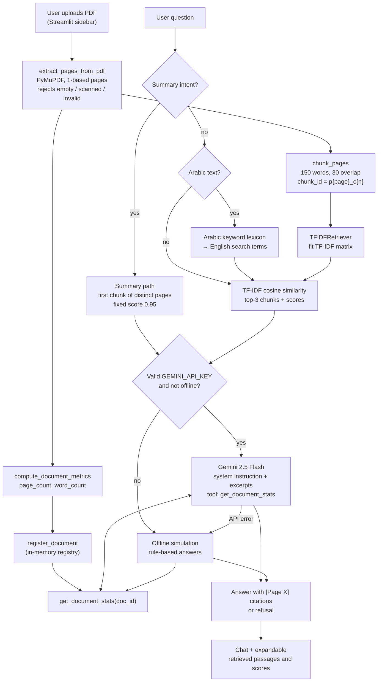

# Architecture: Ask My PDF

*Ask My PDF, developed by Team 2 (SDAIA Academy, Developing Generative AI Solutions workshop).*

This document describes the architecture **as implemented in the current source code**. Where a component is simulated or tuned to the synthetic test document, that is stated explicitly.

## 1. Component overview

| Component | File | Kind of processing | Uses an AI model? |
| :--- | :--- | :--- | :--- |
| Streamlit UI | `app.py` | Upload, chat, document overview, retrieved-passage viewer, SDAIA Academy logo | No |
| PDF extraction | `pdf_processor.py` | PyMuPDF page-by-page text extraction, 1-based page numbers | No (plain extraction) |
| Chunking | `pdf_processor.py` | Word-based sliding window (150 words, 30 overlap) per page | No |
| Retrieval | `retriever.py` | scikit-learn TF-IDF (unigrams + bigrams, English stop words) + cosine similarity, top-k = 3 | No |
| Summary routing | `retriever.py` | Keyword detection of "summary/overview" intent (Arabic + English); returns the first chunk of up to 4 pages sampled evenly across the document, with a **fixed** score of 0.95 | No |
| Arabic query mapping | `retriever.py` | Regex lexicon that maps Arabic keywords to English search terms | No (rule-based, not a translator) |
| Tool | `gemini_service.py` → `get_document_stats` | Returns page and word count of a registered document; validates input | No (deterministic Python) |
| Live generation | `gemini_service.py` → `answer_question` | `google-genai` client, model `gemini-2.5-flash`, temperature 0, system instruction, tool declared (automatic function calling disabled), 20 s request timeout | **Yes**, only when a valid key is configured |
| Offline generation | `gemini_service.py` → `_offline_grounded_answer` | Rule-based answer engine used for tests, with no key, or as fallback on API errors | No (simulation) |

## 2. Data flow



## 3. Step-by-step processing

1. **Upload.** `app.py` reads the uploaded bytes once per new filename.
2. **Extraction.** `extract_pages_from_pdf` opens the bytes with PyMuPDF and collapses whitespace on every page. Page numbers are `index + 1`. A `ValueError` is raised for 0-byte files, unreadable files, 0-page documents, or documents with fewer than 15 extracted characters in total (typically scanned images). The UI shows this as an error message.
3. **Chunking.** `chunk_pages` splits each page independently, so **a chunk never spans two pages** and its page number is always exact. Pages with ≤150 words become one chunk.
4. **Metrics and registration.** `compute_document_metrics` counts pages and whitespace-separated words; `register_document` stores them under the filename. The registry is cleared on each new upload.
5. **Indexing.** `TFIDFRetriever` fits a `TfidfVectorizer(stop_words="english", ngram_range=(1, 2))`. If the corpus contains only stop words it falls back to a unigram vectorizer with no stop words.
6. **Retrieval.** For each question:
   - Summary-intent questions go to `get_summary_chunks` (the scores are an assigned constant, **not** a similarity).
   - Arabic questions are passed through `translate_arabic_query_to_english`, a keyword lexicon. Several mapped term lists contain words specific to the synthetic test document (e.g. "Dr Elena Rostova", "March 15 2025").
   - The result is the top 3 chunks by cosine similarity, **including zero-score chunks**. Zero scores are kept so the generator can refuse.
7. **Generation.** See §4.
8. **Display.** The answer appears in the chat; an expander lists each retrieved chunk with page, chunk id, retrieval mode, and score.

## 4. Live Gemini path vs. offline simulation

### Live path (requires a valid key; **not verified in the current review**)

- Builds a prompt that labels excerpts as **untrusted reference material** and includes page, chunk id, retrieval mode, and similarity for each excerpt.
- Sends it with `SYSTEM_INSTRUCTION` (grounding rules, `[Page X]` citation format, refusal sentences in English and Arabic, prompt-injection rules), `temperature=0.0`, and `tools=[get_document_stats]`.
- The SDK's **automatic function calling is disabled**. If the response contains a `get_document_stats` function call, the app runs the function once and sends the original prompt, the model's call, and a `function_response` in a single follow-up request **without tools**, so no tool loop is possible. This path is covered by test T28 with a mocked client.
- Errors: 401, 403, 404 and 429 responses return a clear warning (detected by searching the error text). Timeouts and **any other exception fall back to the offline simulation** with a notice appended to the answer.
- Each HTTP request has a 20-second timeout (`GEMINI_TIMEOUT_MS = 20000`; the SDK expects milliseconds). Whether this resolves the earlier hang is **not confirmed** by an independent live test.

### Offline simulation (used by all automated tests)

`_offline_grounded_answer` is a **deterministic, rule-based test double**, not a language model. In order:

1. Keyword-based prompt-injection refusal (e.g. "ignore all", "jailbreak", "write a poem", Arabic equivalents).
2. Keyword-based statistics intent → calls the real `get_document_stats` and formats the result.
3. Summary intent → extractive overview: the first substantive sentence of each sampled chunk with its page number, plus a *Coverage Note* when the document has more pages than were sampled.
4. Refusal if no chunk scores above 0.05.
5. Fact templates for the synthetic document (lead, launch date, SLA, chunk size, ISO 27001). A template only fires if the exact fact string is present in a retrieved chunk.
6. Otherwise, the first sentence of the top chunk if its score is above 0.15; else refusal.

Steps 1, 2, 3, 4 and 6 work on any PDF; step 5 only produces answers for the synthetic document.

## 5. The `get_document_stats` tool

```python
get_document_stats(doc_id: str) -> {"doc_id", "page_count", "word_count", "status"}
```

Validation:

| Input | Result |
| :--- | :--- |
| Not a string (e.g. `12345`, `None`) | `TypeError: doc_id must be a string, got <type>` |
| Empty or whitespace-only string | `ValueError: doc_id cannot be empty or whitespace.` |
| Unknown id, **one** document registered | Silently resolves to the registered document (lenient by design, so a model that slightly misnames the file still gets the stats) |
| Unknown id, zero or several documents registered | `ValueError: Document '<id>' not found in registry...` |

The counts come from the actual extracted text, so they are exact for what PyMuPDF extracts; they may differ from a human count if the PDF contains hyphenation, tables, or non-selectable text.
